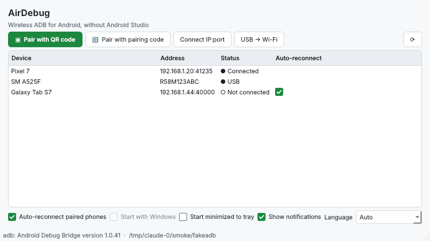
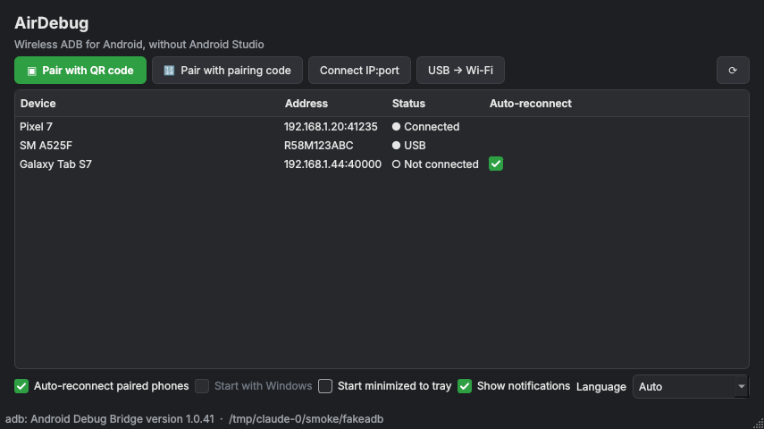
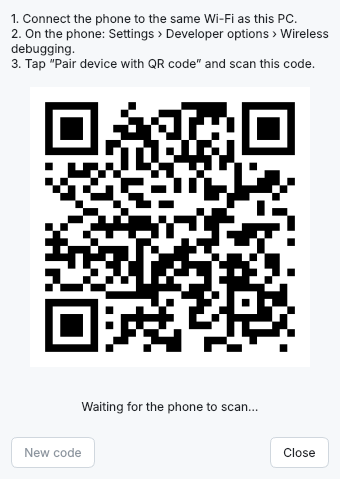
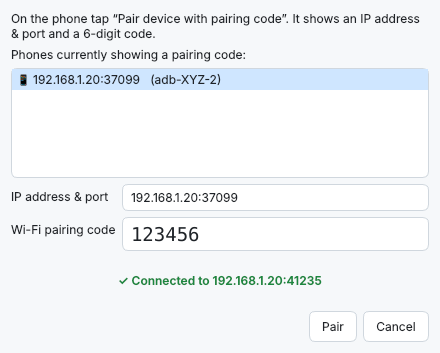

<p align="center">
  
</p>

<h1 align="center">AirDebug</h1>

<p align="center">
  <b>ADB nirkabel untuk Android, tanpa Android Studio.</b><br>
  Pairing HP dengan QR code atau kode 6 digit, lalu biarkan AirDebug menjaga HP tetap tersambung dari system tray Windows.
</p>

<p align="center">
  <a href="https://github.com/bangjohn/AirDebug/releases/latest"><b>⬇ Unduh AirDebug.exe</b></a> ·
  <a href="README.md">🇬🇧 English</a> ·
  <a href="docs/HOW-IT-WORKS.md">Cara kerja (EN)</a>
</p>

---

## Kenapa dibuat?

Debug aplikasi di HP Android biasanya terganggu salah satu dari dua hal ini:

- **Kabel USB.** Port longgar, kabel yang cuma bisa ngecas, atau driver Windows yang rewel bikin HP sering tidak terbaca.
- **Debugging nirkabel harus lewat Android Studio.** Android 11 ke atas bisa debug lewat Wi-Fi, tapi menu pairing-nya ada di *Device Manager* Android Studio. Tanpa itu, kamu harus mengetik `adb pair`, `adb connect`, dan mencari nomor port yang **selalu berubah** setiap kali Debugging nirkabel dimatikan-nyalakan atau HP restart.

**AirDebug** adalah aplikasi Windows kecil untuk menyelesaikan masalah itu:

| | |
|---|---|
| ▣ **Pairing dengan QR code** | Tampilkan QR di PC, pindai dari HP. Selesai. |
| 🔢 **Pairing dengan kode** | HP yang sedang menampilkan kode pairing langsung terdeteksi; tinggal ketik 6 digitnya. |
| 🔄 **Sambung ulang otomatis** | HP yang pernah dipairing diingat dan disambungkan lagi sendiri, walau port atau IP-nya berubah. |
| 🖥️ **Berjalan di system tray** | Bisa ikut jalan saat Windows mulai, duduk di samping jam, dan memberi notifikasi saat HP tersambung atau terputus. |
| 🔌 **USB → Wi-Fi** | Untuk HP lama (Android 10 ke bawah): colok sekali, klik, cabut. |
| 📦 **Tanpa instalasi rumit** | Cukup satu file `.exe`. Kalau `adb` belum ada, AirDebug mengunduh Platform-Tools resmi dari Google. |
| 🌐 **Bahasa Indonesia & English** | Mengikuti bahasa Windows secara otomatis. |
| 🌗 **Mode terang & gelap** | Otomatis mengikuti tema Windows, bahkan saat aplikasi sedang berjalan. |

Setelah tersambung, HP muncul di `adb devices`, Android Studio, VS Code, Flutter, React Native, scrcpy, dan semua alat lain yang memakai adb.

<p align="center">
  <br>
  <br>
   &nbsp;
  
</p>

## Kebutuhan

- Windows 10 atau 11 (64-bit)
- HP dengan **Android 11 atau lebih baru** untuk pairing nirkabel (Android 10 ke bawah: pakai *USB → Wi-Fi*)
- PC dan HP di **jaringan Wi-Fi yang sama** (hotspot HP juga bisa)

## Cara pakai

### 1. Unduh AirDebug

Unduh **`AirDebug.exe`** dari [rilis terbaru](https://github.com/bangjohn/AirDebug/releases/latest), lalu jalankan. Tidak perlu instalasi; taruh di folder mana saja.

> Windows SmartScreen mungkin menampilkan *"Windows protected your PC"* karena exe-nya belum ditandatangani. Klik **More info → Run anyway**. Kamu juga bisa [build sendiri](#build-dari-source).

Saat pertama kali dibuka, kalau adb tidak ditemukan, AirDebug menawarkan untuk mengunduh Platform-Tools dari Google (~7 MB) ke `%APPDATA%\AirDebug\platform-tools`. Kalau Android Studio atau Platform-Tools sudah terpasang, yang sudah ada itu yang dipakai.

### 2. Nyalakan Debugging nirkabel di HP (sekali saja)

1. **Setelan → Tentang ponsel →** ketuk **Nomor versi / Build number** 7 kali sampai *Opsi developer* aktif.
   (Samsung: *Tentang ponsel → Informasi perangkat lunak → Nomor versi*. Xiaomi: *Tentang ponsel → Versi MIUI/OS*.)
2. **Setelan → Sistem → Opsi developer → Debugging nirkabel → Aktif.**
   Izinkan untuk jaringan yang sedang dipakai kalau ditanya.

### 3. Pairing

**Dengan QR code (paling mudah)**

1. Di AirDebug klik **Pairing dengan QR code**.
2. Di HP, di dalam menu *Debugging nirkabel*, ketuk **Sambungkan perangkat dengan kode QR** lalu pindai kode di layar PC.
3. Beberapa detik kemudian HP muncul dengan status **● Terhubung**.

**Dengan kode pairing**

1. Di HP ketuk **Sambungkan perangkat dengan kode penyambungan**. HP menampilkan *alamat IP & port* serta *kode 6 digit*.
2. Di AirDebug klik **Pairing dengan kode**. Biasanya HP langsung muncul di daftar; kalau tidak, ketik IP:port-nya.
3. Ketik kode 6 digit lalu klik **Pairing**.

Pairing cukup sekali per HP dan PC. Setelah itu AirDebug menyambungkan sendiri setiap kali HP ada di Wi-Fi yang sama dengan Debugging nirkabel menyala.

### 4. Langsung debug

```text
> adb devices
List of devices attached
adb-R58M123ABC-AbCdEf._adb-tls-connect._tcp   device
```

Jalankan aplikasi dari Android Studio, `flutter run`, `npx react-native run-android`, `scrcpy`, dan lainnya.

## Fitur lebih detail

### Sambung ulang otomatis

Setiap beberapa detik (dan langsung ketika ada perubahan di jaringan), AirDebug:

1. Memeriksa HP mana yang pernah dipairing tetapi belum tersambung.
2. Mencari alamat dan port *terbaru* HP itu lewat mDNS (HP mengumumkannya di jaringan).
3. Menjalankan `adb connect` dan menampilkan notifikasi: *"Tersambung ulang: Pixel 7"*.

AirDebug juga membersihkan entri `offline` yang basi, yang biasanya menghalangi penyambungan ulang. Kalau jaringanmu memblokir mDNS (Wi-Fi kantor/tamu), AirDebug mencoba alamat terakhir yang diketahui setiap 30 detik.

Sambung ulang otomatis bisa dimatikan untuk semua HP (checkbox atau menu tray) atau per HP (kolom *Sambung otomatis*). Memilih **Putuskan** dari menu klik kanan juga menjeda sambung ulang otomatis untuk HP itu, supaya tidak langsung tersambung lagi.

### System tray

Menutup jendela tidak mematikan AirDebug; aplikasi tetap jalan di tray. Ikon berwarna **hijau** kalau ada HP yang tersambung, **abu-abu** kalau tidak ada. Klik kiri untuk menampilkan/menyembunyikan jendela; klik kanan untuk pairing, daftar perangkat, saklar sambung otomatis, dan *Keluar*.

Centang **Jalankan saat Windows mulai** agar AirDebug terbuka tersembunyi di tray setiap login (menambah entri per-user di `HKCU\…\Run`, tidak butuh hak admin).

### USB → Wi-Fi (Android 10 ke bawah)

Colokkan HP dengan debugging USB diizinkan, klik **USB → Wi-Fi**, pilih HP-nya, lalu cabut kabel. AirDebug menjalankan `adb tcpip 5555`, membaca IP Wi-Fi HP, lalu menyambung. Mode ini perlu kabel lagi setelah HP restart; itu batasan dari Android.

### Menu klik kanan

| Aksi | Fungsi |
|---|---|
| Putuskan | `adb disconnect` dan jeda sambung otomatis untuk HP itu |
| Salin serial | Menyalin serial adb (berguna untuk `adb -s <serial> …`) |
| Sambungkan ulang sekarang | Menjalankan pengecekan sambung ulang saat itu juga |
| Lupakan perangkat | Menghapus dari daftar AirDebug (untuk unpair total, hapus juga PC ini di HP: *Debugging nirkabel → Perangkat yang disambungkan*) |

## Mengatasi masalah

| Masalah | Solusi |
|---|---|
| QR sudah dipindai tapi tidak terjadi apa-apa | PC dan HP harus di jaringan dan subnet yang sama. Pastikan Windows Firewall mengizinkan AirDebug dan adb di jaringan **Private** (setujui prompt saat pertama jalan), dan profil Wi-Fi di Windows diset *Private*, bukan *Public*. |
| "Kode pairing salah" | Kode kedaluwarsa begitu dialog di HP ditutup. Buka lagi dan pakai kode yang baru. |
| HP terus berstatus *◐ Ada di jaringan, menyambung…* | Matikan lalu nyalakan lagi Debugging nirkabel. Kalau pakai VPN di PC atau HP, jeda dulu. |
| HP tidak pernah terdeteksi otomatis (Wi-Fi kantor/tamu) | Jaringan seperti itu sering memblokir mDNS. Pakai **Sambungkan IP:port** dengan alamat yang tertera di layar *Debugging nirkabel*. |
| Status `unauthorized` | Buka kunci HP dan setujui pertanyaan *Izinkan debugging?*. |
| Debugging nirkabel mati sendiri | Android mematikannya saat pindah jaringan Wi-Fi. Nyalakan lagi; AirDebug menyambung tanpa perlu pairing ulang. |
| Masalah lain | Jalankan dengan log: `AirDebug.exe --verbose`, lalu lihat `%APPDATA%\AirDebug\airdebug.log`. Lampirkan di [issue](https://github.com/bangjohn/AirDebug/issues). |

## Opsi command line

```text
AirDebug.exe [--minimized] [--verbose] [--version]
```

| Variabel lingkungan | Fungsi |
|---|---|
| `AIRDEBUG_ADB` | Path lengkap ke `adb.exe` tertentu |
| `AIRDEBUG_HOME` | Folder untuk setelan, log, dan Platform-Tools hasil unduhan (default `%APPDATA%\AirDebug`) |
| `AIRDEBUG_LANG` | Paksa bahasa: `en` atau `id` |

Setelan dan daftar HP tersimpan di `%APPDATA%\AirDebug\airdebug.json`.

## Build dari source

Butuh Python 3.10+ di Windows.

```powershell
git clone https://github.com/bangjohn/AirDebug.git
cd AirDebug
py -3 -m venv .venv
.venv\Scripts\activate
pip install -r requirements-dev.txt

python -m airdebug            # jalankan dari source
pytest                         # jalankan unit test
pyinstaller --clean --noconfirm airdebug.spec   # -> dist\AirDebug.exe
```

Atau cukup jalankan `powershell -ExecutionPolicy Bypass -File scripts\build.ps1`.

Setiap push ke `main` otomatis membangun exe di GitHub Actions (unduh dari bagian *Artifacts* pada run tersebut). Saat GitHub Release dipublikasikan (misalnya tag `v1.0.0`), exe otomatis dibangun dan dilampirkan ke rilis itu.

## Privasi & keamanan

- AirDebug hanya berkomunikasi di jaringan lokal (mDNS + adb), dan sekali ke `dl.google.com` kalau perlu mengunduh Platform-Tools. Tidak ada telemetri.
- Pairing memakai mekanisme TLS bawaan Android. Password di QR dibuat acak dan baru untuk setiap kode.
- PC yang sudah dipairing punya akses debugging penuh ke HP. Pairing hanya dengan PC yang kamu percaya, dan hapus PC lama di HP lewat *Debugging nirkabel → Perangkat yang disambungkan*.

## Lisensi

[Apache License 2.0](LICENSE). Android, Android Studio, dan ADB adalah merek/produk Google LLC; AirDebug adalah proyek independen dan tidak berafiliasi dengan Google.
