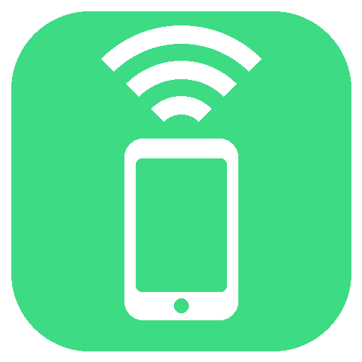
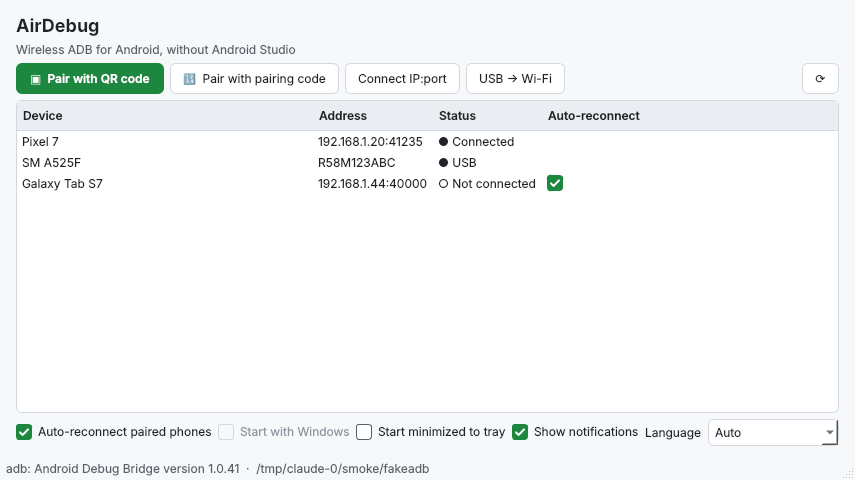
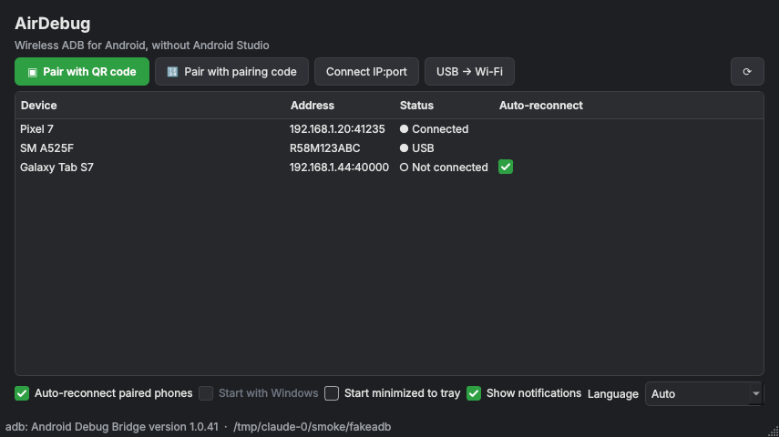
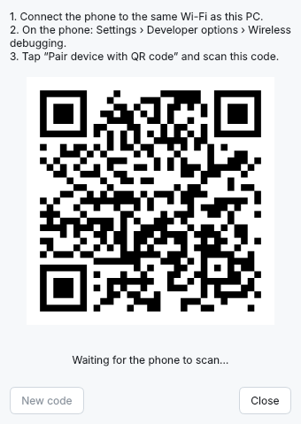
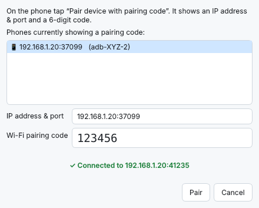

<p align="center">
  
</p>

<h1 align="center">AirDebug</h1>

<p align="center">
  <b>Wireless ADB for Android, without Android Studio.</b><br>
  Pair your phone with a QR code or a 6-digit code, and let AirDebug keep it connected from the Windows system tray.
</p>

<p align="center">
  <a href="https://github.com/bangjohn/AirDebug/releases/latest"><b>⬇ Download AirDebug.exe</b></a> ·
  <a href="README.id.md">🇮🇩 Baca dalam Bahasa Indonesia</a> ·
  <a href="docs/HOW-IT-WORKS.md">How it works</a>
</p>

---

## Why?

Debugging an Android phone usually means one of two annoyances:

- **The USB cable.** Loose ports, charge-only cables and Windows driver hiccups mean the phone often just isn't detected.
- **Wireless debugging needs Android Studio.** Android 11+ supports debugging over Wi-Fi, but pairing is hidden inside Android Studio's *Device Manager*. Without it you have to type `adb pair`, `adb connect` and hunt for a port number that **changes every time** Wireless debugging is toggled or the phone reboots.

**AirDebug** is a small Windows app that fixes this:

| | |
|---|---|
| ▣ **Pair with QR code** | Show a QR code on your PC, scan it from the phone. Done. |
| 🔢 **Pair with code** | Phones showing a pairing code are found automatically; just type the 6 digits. |
| 🔄 **Auto-reconnect** | Remembers paired phones and reconnects them by itself, even when the port or IP changes. |
| 🖥️ **Lives in the tray** | Starts with Windows (optional), sits next to the clock, and notifies you when a phone connects or drops. |
| 🔌 **USB → Wi-Fi** | For older phones (Android ≤ 10): plug in once, click, unplug. |
| 📦 **No setup** | One `.exe`. If `adb` isn't installed, AirDebug downloads Google's official Platform-Tools for you. |
| 🌐 **English & Bahasa Indonesia** | Picks your Windows language automatically. |
| 🌗 **Light & dark mode** | Follows the Windows app theme automatically, even while running. |

Once connected, the phone shows up in `adb devices`, Android Studio, VS Code, Flutter, React Native, scrcpy… everything that uses adb.

<p align="center">
  <br>
  <br>
   &nbsp;
  
</p>

## Requirements

- Windows 10 or 11 (64-bit)
- An Android phone with **Android 11 or newer** for wireless pairing (Android 10 and older: use *USB → Wi-Fi*)
- PC and phone on the **same Wi-Fi network** (hotspots work too)

## Quick start

### 1. Get AirDebug

Download **`AirDebug.exe`** from the [latest release](https://github.com/bangjohn/AirDebug/releases/latest) and run it. No installation is needed; put it anywhere you like.

> Windows SmartScreen may say *"Windows protected your PC"* because the exe is not code-signed. Click **More info → Run anyway**. You can also [build it yourself](#build-from-source).

On first launch, if adb is not found, AirDebug offers to download Google's Platform-Tools (~7 MB) into `%APPDATA%\AirDebug\platform-tools`. If you already have Android Studio or Platform-Tools installed, that copy is used instead.

### 2. Turn on Wireless debugging on the phone (one time)

1. **Settings → About phone →** tap **Build number** 7 times to unlock *Developer options*.
   (Samsung: *About phone → Software information → Build number*. Xiaomi: *About phone → MIUI/OS version*.)
2. **Settings → System → Developer options → Wireless debugging → On.**
   Allow it for the current network when asked.

### 3. Pair

**With a QR code (easiest)**

1. In AirDebug click **Pair with QR code**.
2. On the phone, inside *Wireless debugging*, tap **Pair device with QR code** and scan the code on your screen.
3. A few seconds later the phone appears as **● Connected**.

**With a pairing code**

1. On the phone tap **Pair device with pairing code**. It shows an *IP address & port* and a *6-digit code*.
2. In AirDebug click **Pair with pairing code**. The phone is usually listed automatically; otherwise type the IP:port.
3. Type the 6-digit code and click **Pair**.

You only pair once per phone and PC. After that AirDebug reconnects on its own whenever the phone is on the same Wi-Fi with Wireless debugging enabled.

### 4. Use it

```text
> adb devices
List of devices attached
adb-R58M123ABC-AbCdEf._adb-tls-connect._tcp   device
```

Run your app from Android Studio, `flutter run`, `npx react-native run-android`, `scrcpy`, and so on.

## Features in detail

### Auto-reconnect

Every few seconds (and immediately when something changes on the network), AirDebug:

1. Looks at which remembered phones are not connected.
2. Finds their *current* address and port via mDNS (the phone announces it on the network).
3. Runs `adb connect` and shows a notification: *"Reconnected Pixel 7"*.

It also removes stale `offline` entries that otherwise block reconnecting. If your network blocks mDNS (some office/guest Wi-Fi), AirDebug falls back to the last known address every 30 seconds.

You can turn auto-reconnect off globally (checkbox or tray menu) or per phone (the *Auto-reconnect* column). Choosing **Disconnect** from a phone's right-click menu also pauses auto-reconnect for that phone so it doesn't come straight back.

### System tray

Closing the window keeps AirDebug running in the tray. The icon is **green** when at least one phone is connected and **grey** otherwise. Left-click toggles the window; right-click gives quick access to pairing, the device list, the auto-reconnect switch and *Quit*.

Tick **Start with Windows** to launch AirDebug minimized at login (it adds a per-user entry in `HKCU\…\Run`, no admin rights needed).

### USB → Wi-Fi (Android 10 and older)

Plug the phone in with USB debugging allowed, click **USB → Wi-Fi**, pick the phone, then unplug. AirDebug runs `adb tcpip 5555`, reads the phone's Wi-Fi IP and connects. This mode needs the cable again after the phone reboots; that's an Android limitation.

### Right-click menu

| Action | What it does |
|---|---|
| Disconnect | `adb disconnect` and pause auto-reconnect for that phone |
| Copy serial | Copy the adb serial (handy for `adb -s <serial> …`) |
| Reconnect now | Run a reconnect pass immediately |
| Forget device | Remove it from AirDebug's list (to unpair completely, also remove the PC on the phone under *Wireless debugging → Paired devices*) |

## Troubleshooting

| Problem | Fix |
|---|---|
| QR code is scanned but nothing happens | PC and phone must be on the same network and subnet. Check that Windows Firewall allows AirDebug and adb on **Private** networks (accept the prompt on first run), and that the Wi-Fi is set to *Private*, not *Public*. |
| "Wrong pairing code" | Codes expire when the dialog on the phone closes. Open it again and use the new code. |
| Phone listed as *◐ On network, connecting…* forever | Toggle Wireless debugging off and on. If you use a VPN on the PC or phone, pause it. |
| Phone is never found automatically (guest/office Wi-Fi) | Those networks often block mDNS. Use **Connect IP:port** with the address shown on the *Wireless debugging* screen. |
| `unauthorized` | Unlock the phone and accept the *Allow debugging?* prompt. |
| Wireless debugging turns itself off | Android disables it when you change Wi-Fi network. Re-enable it; AirDebug reconnects without pairing again. |
| Something else | Run with logs: `AirDebug.exe --verbose`, then look at `%APPDATA%\AirDebug\airdebug.log`. Please attach it to an [issue](https://github.com/bangjohn/AirDebug/issues). |

## Command-line options

```text
AirDebug.exe [--minimized] [--verbose] [--version]
```

| Environment variable | Purpose |
|---|---|
| `AIRDEBUG_ADB` | Full path to a specific `adb.exe` to use |
| `AIRDEBUG_HOME` | Folder for settings, logs and downloaded Platform-Tools (default `%APPDATA%\AirDebug`) |
| `AIRDEBUG_LANG` | Force the UI language: `en` or `id` |

Settings and remembered phones live in `%APPDATA%\AirDebug\airdebug.json`.

## Build from source

You need Python 3.10+ on Windows.

```powershell
git clone https://github.com/bangjohn/AirDebug.git
cd AirDebug
py -3 -m venv .venv
.venv\Scripts\activate
pip install -r requirements-dev.txt

python -m airdebug            # run from source
pytest                         # run the unit tests
pyinstaller --clean --noconfirm airdebug.spec   # -> dist\AirDebug.exe
```

Or just run `powershell -ExecutionPolicy Bypass -File scripts\build.ps1`.

Every push to `main` builds the exe on GitHub Actions (download it from the run's *Artifacts*). Publishing a GitHub Release (for example tag `v1.0.0`) builds the exe and attaches `AirDebug.exe` to it automatically.

AirDebug is written in Python with Qt (PySide6), so it also runs from source on Linux and macOS, although Windows is the main target.

### Project layout

```text
airdebug/
  adb.py          locate/download adb, run it, parse its output
  discovery.py    mDNS browser for _adb-tls-pairing / _adb-tls-connect
  core.py         pairing flows, connect, auto-reconnect (no Qt, unit tested)
  store.py        remembered phones + settings (JSON)
  i18n.py         English / Bahasa Indonesia strings
  autostart.py    "Start with Windows"
  app.py          entry point, single-instance guard, first-run adb download
  ui/             main window, tray icon, pairing dialogs
tests/            pytest suite with fake adb + fake mDNS
```

See [docs/HOW-IT-WORKS.md](docs/HOW-IT-WORKS.md) for the protocol details.

## Privacy & security

- AirDebug only talks to your local network (mDNS + adb) and, once, to `dl.google.com` if it has to download Platform-Tools. No telemetry.
- Pairing uses Android's own TLS pairing. The QR password is random and new for every code.
- Pairing a PC gives it full debugging access to the phone. Only pair PCs you trust, and remove old ones on the phone under *Wireless debugging → Paired devices*.

## Contributing

Bug reports, translations and pull requests are welcome. See [CONTRIBUTING.md](CONTRIBUTING.md).

## License

[Apache License 2.0](LICENSE). Android, Android Studio and ADB are trademarks/products of Google LLC; AirDebug is an independent project and is not affiliated with Google. Platform-Tools are downloaded from Google under their own license.
